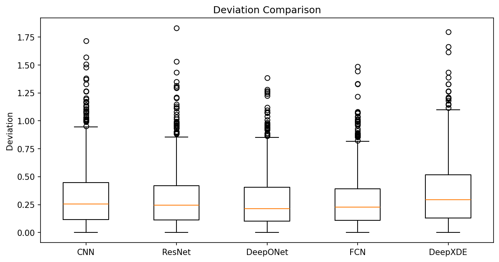
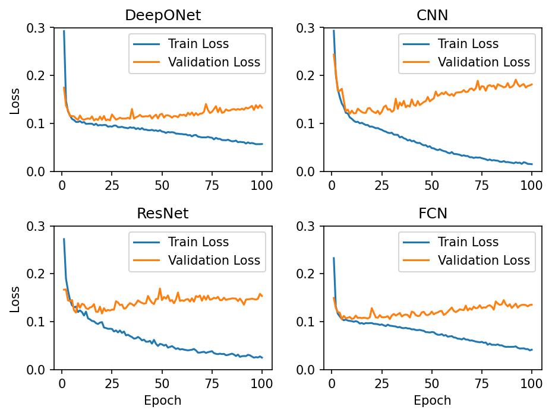

# Temperature Forecasting with DeepONet

A comparison of DeepONet, implemented in both PyTorch and DeepXDE, against CNN, ResNet and fully connected baselines for forecasting the next day's mean temperature from the previous 30 days of Kitchener-Waterloo climate data.

Team course project for **AMATH 900 Scientific Machine Learning** (University of Waterloo, Fall 2024), by Xin Ming Li and Zian Wang.

## Results at a glance



| Model | Validation MSE after training | Lowest validation MSE during training |
|---|---|---|
| **DeepONet (PyTorch)** | **0.133** | 0.106 (epoch 16) |
| Fully connected network | 0.136 | 0.106 (epoch 5) |
| ResNet | 0.154 | 0.117 (epoch 20) |
| CNN | 0.182 | 0.119 (epoch 24) |
| DeepONet (DeepXDE) | 0.208 | 0.199 (step 83) |

The figure and numbers are the saved outputs of the notebook in this repository. Each box shows a model's absolute error on the validation days. All models use the same 80/20 split, Adam, learning rate 0.001, batch size 32 and MSE loss. Temperatures are standardized (z-scores), so errors are in units of one standard deviation of daily mean temperature.

## Setup

### 1. Requirements

- **Python 3.11.** The DeepXDE part needs TensorFlow 2.15, which supports Python 3.9 to 3.11 only.
- A CPU is enough. Training all five models takes about 10 minutes.

### 2. Create a virtual environment

Run these from the folder that contains `deeponet_weather_forecasting.ipynb`.

Windows (PowerShell), using the Python launcher:

```powershell
py -3.11 -m venv .venv
.venv\Scripts\Activate.ps1
```

macOS / Linux:

```bash
python3.11 -m venv .venv
source .venv/bin/activate
```

### 3. Install the libraries

```bash
pip install -r requirements.txt
```

### 4. Data

The data is included in [`KitchenerWaterloo/`](KitchenerWaterloo): daily climate observations for station KITCHENER/WATERLOO (Climate ID 6144239), one CSV per year from 2010 to 2024, downloaded from [Environment and Climate Change Canada](https://climate.weather.gc.ca/historical_data/search_historic_data_e.html).

## How it works

DeepONet (Lu et al., 2021) learns an **operator** $G$ that maps an input function $u$ to an output function $G(u)$. It has two sub-networks:

- the **branch net** encodes $u$, sampled at fixed sensor points $x_1, \dots, x_m$;
- the **trunk net** encodes the location $y$ where the output function is evaluated.

The prediction combines the two:

$$G(u)(y) \approx \sum_{k=1}^{p} b_k\big(u(x_1), \dots, u(x_m)\big)\, t_k(y)$$

For forecasting, each training example is a 30-day window:

| DeepONet term | Meaning here |
|---|---|
| $x_1, \dots, x_{30}$ | the 30 past dates |
| $u(x_1), \dots, u(x_{30})$ | the mean temperatures on those dates |
| $y$ | the next date |
| $G(u)(y)$ | the mean temperature on the next date |

The branch net receives the 30 dates and 30 temperatures (60 inputs). The trunk net receives the target date.

## Models

| Model | Architecture |
|---|---|
| DeepONet (PyTorch) | Branch 60 → 64 → 64 and trunk 1 → 64 → 64, ReLU. The branch and trunk outputs are multiplied element-wise and passed through a linear layer (64 → 1). |
| DeepONet (DeepXDE) | `dde.maps.OpNN` with the same layer sizes, ReLU and Glorot normal initialisation. Branch and trunk outputs are combined by a dot product, with no bias. |
| CNN | Three 1-D convolutions (2 → 16 → 32 → 64 channels, kernel 3), each followed by ReLU and max pooling, then two fully connected layers (128 → 1). Dates and temperatures are the two input channels. |
| ResNet | A 1-D ResNet: a 7-wide stem convolution, then three stages of two residual blocks (16, 32 and 64 channels) with batch normalization, then global average pooling and a linear output. |
| Fully connected network | 60 → 128 → 64 → 1 with ReLU. |

## Data and training

- **Cleaning:** rows with a missing mean temperature are dropped.
- **Normalization:** mean temperature is standardized to zero mean and unit variance. Dates are converted to day numbers (`Timestamp.toordinal`) and standardized the same way.
- **Windows:** sliding 30-day windows, each paired with the following day's temperature.
- **Split:** 80% training, 20% validation, using `torch.utils.data.random_split`.
- **Training:** 100 epochs for the PyTorch models; Adam, learning rate 0.001, batch size 32, MSE loss.



## Discussion

- **DeepONet has the lowest error after 100 epochs**, closely followed by the fully connected network, then ResNet and the CNN. In six runs made while preparing this repository (on Windows and Linux, one with a fixed seed), DeepONet always finished first, ahead of the next model by 0.003 to 0.015. The order of the fully connected network and ResNet changed between runs.
- **The margin comes mostly from overfitting less.** Every model reaches its lowest validation error early, and then the validation error rises while the training error keeps falling. At their best epochs, DeepONet and the fully connected network are level (both 0.106). DeepONet's validation error rises the least afterwards, so it ends with the lowest error.
- **The advantage is small.** The data is low-dimensional (one variable per day) and real rather than synthetic. The DeepONet paper reports larger gains on synthetic operator-learning problems.

## Notes on the evaluation

- **There is no separate test set.** The "test MSE" printed in the notebook is the validation MSE after the last epoch. The "lowest" column above was picked using that same validation set, so it is optimistic.
- **The DeepXDE row** reports the validation loss at the step with the lowest training loss, which is how DeepXDE chooses its best model.
- **No random seed is set.** The split, weight initialisation and batch order change on every run, so results vary from run to run.
- **File order on Linux and macOS.** The notebook loads the CSVs in the order `os.listdir` returns them. Windows returns them alphabetically, which is chronological here. Other systems may not, and then the days end up out of order and the 30-day windows mix different years. If you run it on Linux or macOS, change `os.listdir(directory)` to `sorted(os.listdir(directory))` in the first code cell.

## Acknowledgements

- L. Lu, P. Jin, G. Pang, Z. Zhang and G. E. Karniadakis, [Learning nonlinear operators via DeepONet based on the universal approximation theorem of operators](https://doi.org/10.1038/s42256-021-00302-5), *Nature Machine Intelligence* 3, 218–229 (2021). Code: [lululxvi/deeponet](https://github.com/lululxvi/deeponet).
- L. Lu, X. Meng, Z. Mao and G. E. Karniadakis, [DeepXDE: A deep learning library for solving differential equations](https://doi.org/10.1137/19M1274067), *SIAM Review* 63(1), 208–228 (2021). Code: [lululxvi/deepxde](https://github.com/lululxvi/deepxde).
- Climate data from [Environment and Climate Change Canada](https://climate.weather.gc.ca/historical_data/search_historic_data_e.html). Contains information licensed under the [Open Government Licence – Canada](https://open.canada.ca/en/open-government-licence-canada).

```bibtex
@article{lu2021deeponet,
  title   = {Learning nonlinear operators via {DeepONet} based on the universal approximation theorem of operators},
  author  = {Lu, Lu and Jin, Pengzhan and Pang, Guofei and Zhang, Zhongqiang and Karniadakis, George Em},
  journal = {Nature Machine Intelligence},
  volume  = {3},
  number  = {3},
  pages   = {218--229},
  year    = {2021},
  doi     = {10.1038/s42256-021-00302-5}
}
```
